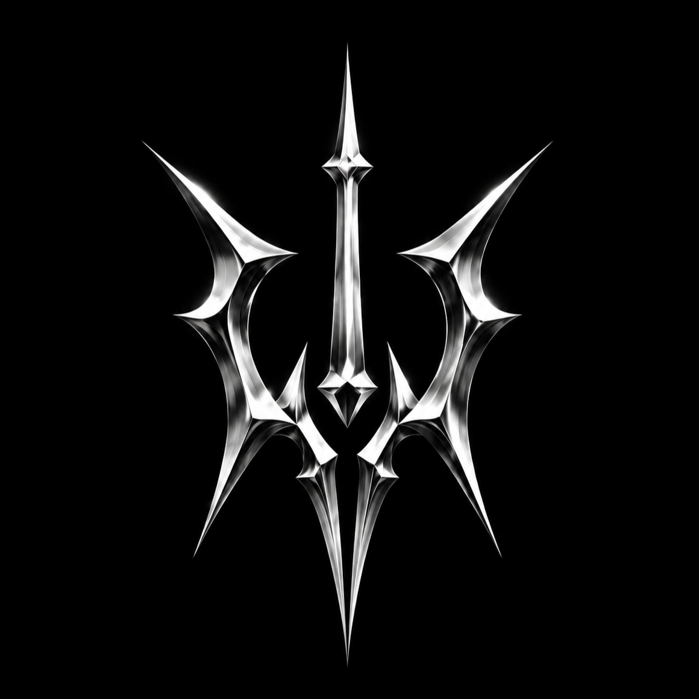
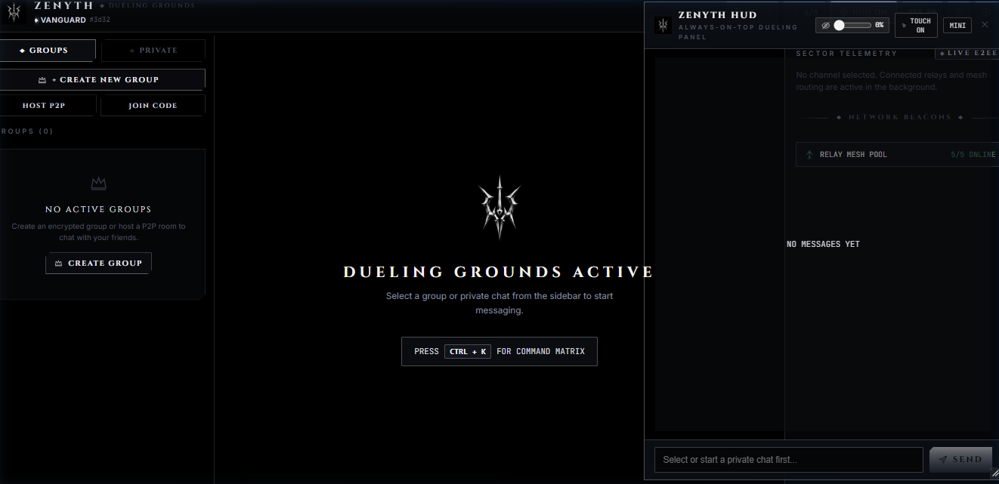
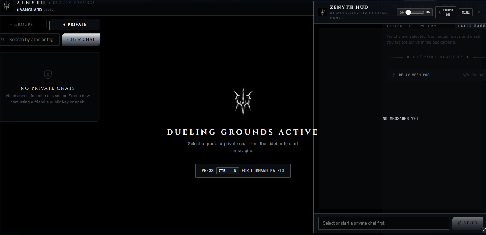
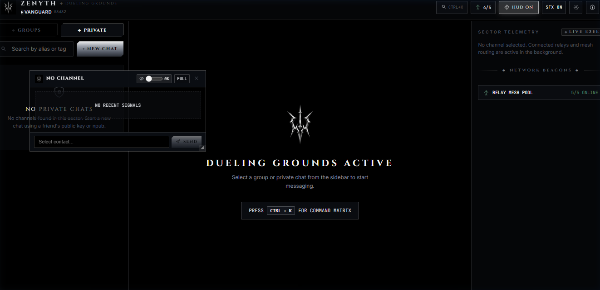
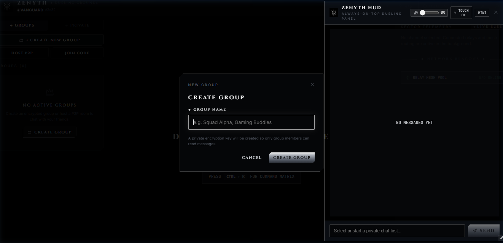
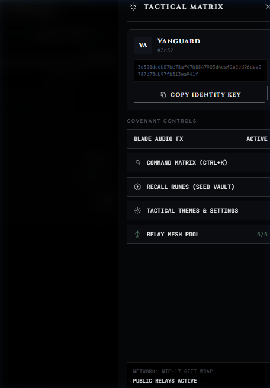
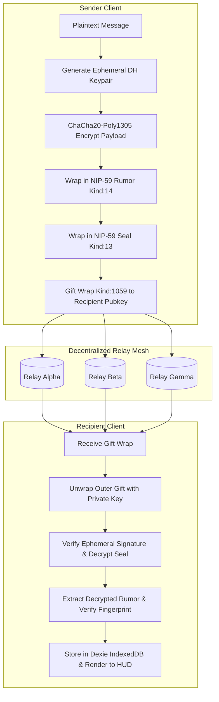

<p align="center">
  
</p>

<h1 align="center">ZENYTH // DUELING GROUNDS</h1>

<p align="center">
  <strong>Serverless, End-to-End Encrypted Gamer Chat with Always-On-Top In-Game HUD Overlay</strong>
</p>

<p align="center">
  <a href="https://github.com/ImpactG1/zChat/releases"></a>
  <a href="LICENSE"></a>
  <a href="https://github.com/ImpactG1/zChat/actions/workflows/build-apk.yml"></a>
  <a href="#"></a>
  <a href="#"></a>
  <a href="#"></a>
  <a href="CONTRIBUTING.md"></a>
</p>

---

## ⚡ Overview

**Zenyth** is a sovereign, censorship-resistant messaging platform designed specifically for competitive gamers, streamers, and privacy purists. 

Traditional gamer chat apps harvest user telephone numbers, monetise private metadata, and crash games with bloated Electron memory leaks. **Zenyth changes the rules:**

- 🌐 **Zero Centralised Servers:** Built entirely on distributed Nostr relays (NIP-17 / NIP-44 / NIP-59) and direct WebRTC peer-to-peer mesh rooms.
- 🛡️ **Cryptographic Sovereignty:** Authenticated ChaCha20-Poly1305 encryption with onion-style Gift Wrapping. Relays only observe ephemeral random noise.
- 🎮 **Tactical In-Game Overlay HUD:** An always-on-top, draggable, resizable HUD with **Ghost Mode (0%–100% translucency)** and **Click-Through (Pass-Through)** mode so you never miss team callouts or lose game visibility.
- 🗡️ **Obsidian Void Aesthetics:** Inspired by high-end gaming hardware and monolithic dark minimalism. Zero corporate pastel gradients, razor chamfers, liquid chrome accents, and synthesized blade audio feedback.

---

## 🖥️ Product Showcase

### 1. Tactical 3-Column Desktop Interface
A clean, focused command center with live cryptographic telemetry, network beacon mesh pools, encrypted group channels, and 1:1 private chats.

<p align="center">
  
</p>

---

### 2. Always-On-Top In-Game Overlay HUD
Float the HUD directly over *Valorant, CS2, Apex Legends, League of Legends, or Minecraft*. Move it anywhere, resize it to your setup, and tweak transparency so your crosshairs are never obstructed.

<p align="center">
  
</p>

- **Dual Window Modes:** Seamlessly toggle between full chat switcher and the ultra-compact stealth mini sigil.
- **Fail-Safe Recoverable Pass-Through:** In `TOUCH ON` (click-through) mode, clicks pass directly through to the game beneath, while a pinned `[PASS-THRU ON [RESTORE TOUCH]]` recovery badge ensures you can restore normal interactions instantly.
- **0% Ghost Transparency:** Fade the window completely to zero opacity while keeping text and message bubbles legible.

<p align="center">
  
</p>

---

### 3. Encrypted Groups & Instant P2P Rooms
Form sovereign groups with dynamic shared symmetric ratchets (Epoch key rotations), or spin up sub-20ms direct WebRTC squad mesh rooms using simple 6-character room codes.

<p align="center">
  
</p>

---

### 4. Mobile Responsive & Android Native Overlay
Responsive on any screen size with an integrated slide-over Tactical Matrix drawer and native Android `WindowManager` `SYSTEM_ALERT_WINDOW` Chat Heads.

<p align="center">
  
</p>

---

## 🔒 Cryptographic Architecture



### Security Guarantees

| Property | Implementation | Guarantee |
| :--- | :--- | :--- |
| **Confidentiality** | ChaCha20-Poly1305 symmetric cipher | Only intended recipient / group can read messages |
| **Metadata Privacy** | NIP-59 Gift Wrapping | Relays cannot see sender identity, timestamps, or recipient list |
| **Forward Secrecy** | Epoch Key Ratcheting & Ephemeral DH | Past messages remain unrecoverable if current key compromised |
| **Identity Sovereignty** | secp256k1 keypairs (BIP-39 12 words) | No phone numbers, emails, or KYC required |
| **Transport Redundancy** | Multi-relay broadcast + WebRTC fallback | Immune to individual relay outages or ISP blocks |

---

## 🛠️ Technology Stack

- **Core Frontend:** React 19, TypeScript, Vite
- **Styling Architecture:** Pure Vanilla CSS, Design Tokens, Obsidian Void theme variables
- **Local Storage Engine:** Dexie.js (IndexedDB) with zero mock dependencies
- **Nostr Cryptography:** `@noble/curves`, `@noble/ciphers`, `@noble/hashes`, `@scure/bip39`, `nostr-tools`
- **P2P Mesh Signaling:** Trystero WebRTC (BitTorrent / IPFS / Relay trackers)
- **Desktop Runtime:** Electron frameless always-on-top transparent container
- **Mobile Container:** Capacitor 7 + Native Android Kotlin Foreground Service Overlay
- **Installer:** Inno Setup Windows Compiler (`installer.iss`)

---

## 🚀 Quick Start

### Prerequisites
- [Node.js](https://nodejs.org/) v20.x or higher
- `npm` or `pnpm`

### Installation

```bash
# 1. Clone the repository
git clone https://github.com/ImpactG1/zChat.git
cd zChat

# 2. Install dependencies
npm install

# 3. Start local development server
npm run dev
```

Visit `http://localhost:5173/` in your browser.

---

## 💻 Running Desktop & Native Overlay

### Launch Frameless Desktop Client (Electron)

```bash
npm run desktop:dev
```

### Build Production Bundle

```bash
npm run build
```

### Build Windows Executable (.exe)
Compile the standalone installer using Inno Setup with the pre-configured script:
```bash
# Ensure Inno Setup 6 (ISCC) is installed
iscc installer.iss
```

### Build Android APK
Android builds are automatically compiled via GitHub Actions (`.github/workflows/build-apk.yml`) on every push to `main`. You can also build locally:
```bash
npx cap sync android
cd android && ./gradlew assembleDebug
```

---

## 🤝 Contributing & Community

We welcome contributions from developers, designers, cryptographers, and gamers!

1. Check out our [Contributing Guide](CONTRIBUTING.md) for details on code style, branch conventions, and testing.
2. Read the [Code of Conduct](CODE_OF_CONDUCT.md).
3. Browse [Open Issues](https://github.com/ImpactG1/zChat/issues) or submit a [Pull Request](https://github.com/ImpactG1/zChat/pulls).

---

## 🏆 GitHub Badges & Achievements

Contribute to Zenyth to earn GitHub achievement badges:

- 🦈 **Pull Shark:** Submit a Pull Request and get it merged into `main`.
- 👯 **Pair Extraordinaire:** Co-author commits on tactical overlay features.
- ⚡ **Quickdraw:** Close an issue or PR within minutes of opening.
- 🌟 **Star:** Star this repo and flex your sovereign gamer setup!

---

## 📄 License

Distributed under the **MIT License**. See [`LICENSE`](LICENSE) for more information.

---

<p align="center">
  <em>Crafted for warriors, privacy advocates, and competitive squads. Zero servers. Total sovereignty.</em>
  <br />
  <strong>⚔️ Z E N Y T H // D U E L I N G &nbsp; G R O U N D S ⚔️</strong>
</p>
